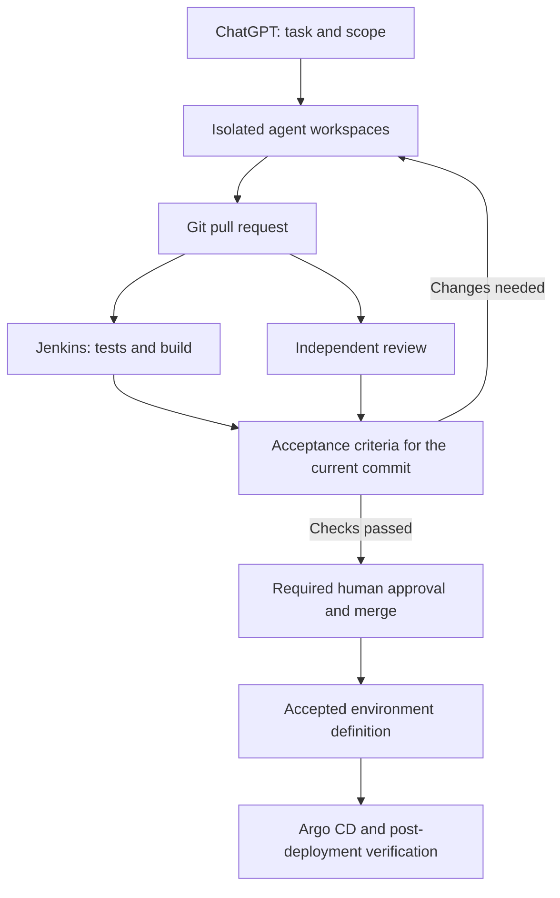

I no longer see my development environment simply as a place to open a project and write code. I also manage research, implementation, testing, review and deployment from wherever I am, using tools running on Kubernetes and agents with defined responsibilities.

When an idea comes to me away from my computer, I record it as a task. When a service fails, I can start an investigation from my phone. While I work on something else, agents collect evidence, inspect the relevant code and prepare a change I can assess.

I need to see which files changed, which tests passed and which decisions are waiting for my approval. Progress matters, but so does being able to understand how that progress happened.

In [my article about how I use AI](https://fmarslan.com/en/2026/08/07/how-i-use-ai-operations-without-giving-up-decisions.html), I described my approach as “operations are automated, decisions stay with me.” I apply the same approach to my development environment.

Argo CD, Codex App Server, browser-accessible VS Code, Git repositories and Jenkins pipelines are parts of this setup. The design work is deciding how responsibility, permissions and verification move between them.

## From a portable environment to one that can keep working

In [an earlier article about my development environment](https://fmarslan.com/en/2025/12/01/my-development-environment-a-lightweight-portable-and-simple-approach.html), I described a setup built around Dev Containers. I wanted each project's tools to stay inside its own environment, without spreading dependencies across my computer, and to make continuing on another device easier.

While [working on TAR Vault Sync](https://fmarslan.com/en/2026/09/20/tar-vault-sync-from-idea-to-first-release-in-24-hours.html), another part of that need became clear: restoring source code does not restore the whole workspace. Configuration, secret sources, connections and verification steps also belong to the environment.

On the same project, I used separate agent roles for requirements, architecture, development and independent QA. I found that clearly defining scope and acceptance criteria mattered more than increasing the number of agents.

I bring those two experiences together: a workspace that can be recreated, and agents that can continue bounded tasks inside it.

Kubernetes gives me a shared foundation for managing workspaces, supporting services and temporary test environments. In return, I take on platform maintenance, access policies and resource costs.

## Giving each component a clear responsibility

I keep the responsibilities of the components explicit:

| Component | Responsibility |
|---|---|
| Remote access through ChatGPT | Start tasks from my phone, direct agents and assess their results |
| Codex App Server | Run agent sessions and send work events and approval requests to a client |
| Browser access to VS Code | Inspect the code, terminal and workspace directly when needed |
| Git and pull requests | Version changes, reviews and the history of decisions |
| Jenkins | Run builds, tests, image creation and manifest checks |
| Argo CD | Reconcile the accepted environment definition in Git with Kubernetes |

ChatGPT's remote working capabilities are particularly useful to me on mobile. I use ChatGPT to start tasks, direct agents and assess results from my phone instead of building a separate mobile application.

Codex App Server is a separate component I use for agent sessions, work events and approval requests. Each tool has its own responsibility: submitting a task remotely, running an agent session and obtaining CI results are distinct operations. [Codex App Server documentation](https://developers.openai.com/codex/app-server)

For VS Code, I also distinguish the browser editor from the actual runtime. Terminal access, builds and debugging need a working environment behind the editor. Connecting the browser editor to a remote environment lets me inspect it manually when necessary. [VS Code for the Web](https://code.visualstudio.com/docs/remote/vscode-web)

My phone is where I start a task and assess its result. When a detailed inspection is needed, I continue the same work on my computer.

## Specialising agents while limiting their permissions

I divide work by responsibility rather than giving one agent the entire repository and full cluster access.

The analysis agent clarifies the need and identifies acceptance criteria. The implementation agent changes the relevant code. The platform agent examines Helm, Kustomize and Kubernetes manifests. The test agent checks whether the change produces the expected behaviour.

A role name in a prompt does not create expertise by itself. I also define the documentation an agent should read, the tools it can use, the files it can change and the evidence it must produce.

For a Deployment change, for example, the platform agent should look beyond YAML syntax. It should examine probes, resource limits, the service account, volume relationships and rollout effects. The implementation agent should fix the problem while preserving existing contracts and user behaviour.

I use a separate workspace for each agent. Git worktrees or separate checkouts help organise concurrent changes. When I need a security boundary, separate pods, operating system permissions and distinct identities are also necessary.

Work can proceed in parallel, but changes to shared files need controlled integration.

## A separate App Server for independent review

One of the parts I care about most is a review layer that operates separately from the development flow.

The coding agent can explain its solution. The reviewer should examine the requirements, changed files, test results and environment policies directly instead of relying on that explanation.

I therefore use a separate App Server process, context and access identity for review. The reviewer can read source code and CI results and leave findings on the PR. It cannot deploy to production or bypass its review role to merge the change.

I want the review to answer concrete questions:

- Which file or behaviour has a problem?
- Under what conditions could it occur?
- What would its impact be?
- What evidence or test is missing?
- What must change before the PR is merged?

Separate App Server processes do not make model errors completely independent. Models from the same family may share assumptions. For risky changes, cross-review with another model, automated checks and my own assessment need to work together.

Review must also be tied to a commit. If new code arrives after approval, the old review should not cover it automatically. Tests and review need to apply to the version that will actually be merged.

## A development task that starts on my phone

Consider this example task:

> “The order service can create duplicate records when the same message arrives again. Inspect the flow, write a test that reproduces the problem and bring the fix as a PR. Do not deploy to production.”

When I submit the task through ChatGPT, I specify the repository, target environment, acceptance criteria and permitted actions. Those boundaries should also be visible in the task record and PR.

The analysis agent examines message consumption. The implementation agent prepares the fix. The test agent verifies repeated delivery and the relevant failure conditions. If a manifest change is necessary, the platform agent assesses that part separately.

Jenkins runs the build and tests for the PR. Its Kubernetes plugin can run build work in temporary agent pods, with tools and resources defined for the pipeline's needs. [Jenkins Kubernetes plugin](https://plugins.jenkins.io/kubernetes/)

The independent reviewer examines the current change. Findings return to the task flow, and the relevant checks run again after corrections.

The result I assess from my phone should contain a summary, the PR link, passing tests, open findings and the decision required. A fix might prevent new duplicates while cleaning up existing duplicate data remains a separate decision.

That keeps the boundary between development and a data correction operation visible.

## Keeping Jenkins and Argo CD within their boundaries

The approach I described in [my article about Kubernetes, Helm, Kustomize and GitOps](https://fmarslan.com/en/2026/07/28/what-are-kubernetes-kustomize-helm-charts-and-gitops.html) also underpins this setup.

Jenkins verifies the code, builds the image and pushes it to the registry. The image digest enters the definition in the environment repository. That change goes through its own review and approval process.

Argo CD applies the accepted environment definition to the cluster. Automatic sync, self-healing of live changes and pruning resources removed from Git are separate behaviours that need deliberate choices for each environment. [Argo CD automated sync policy](https://argo-cd.readthedocs.io/en/stable/user-guide/auto_sync/)

I use different permission models for development and production. I separate changes that can proceed under predefined rules from changes requiring explicit approval according to their effect on the environment.

Keeping production secrets out of PR builds is part of that separation. An agent that can edit a pipeline file or build script should not be able to expand its own permissions through those changes.

I also assess deployment beyond whether the pods have started. The relevant business flow, error rate and user-visible behaviour need verification.

## Collecting evidence before intervening

I use the same environment for operational investigations. An example request from my phone might be:

> “Timeouts in the payment service increased after the last deployment. Compare recent changes with logs, metrics and traces. Analyse first; do not change the environment.”

The agent begins with read-only tools. It collects the deployment time, running image, pod events, resource usage and relevant error examples.

The observability I discussed in [my article about why debugging is not enough in event-driven systems](https://fmarslan.com/en/2025/11/29/why-is-debug-not-enough-in-event-driven-architecture-on-tracing-replay-and-true-observability.html) becomes useful here too. A single service's logs rarely explain a distributed flow. Trace and correlation information give the agent a stronger basis for investigation.

The report should separate findings from hypotheses:

> “Errors increased after the latest deployment. Connection pool wait time rose in the affected calls. The new configuration is a possible cause; a comparison test in staging is needed to verify it.”

This gives me a basis for deciding whether to intervene. When evidence is missing, the agent needs to say so.

I also preserve the GitOps approach during rollback. Restoring a previous image digest through the environment repository should remain traceable. If a database migration is involved, reverting the application version alone may be insufficient; compatibility needs a separate assessment.

## What full automation means to me

I delegate research, development, testing, review and deployment preparation to agents wherever practical. I keep decisions visible within the same flow.

That means versioning working rules alongside the code. Agent instructions, acceptance criteria, the Jenkinsfile, Kubernetes manifests and operational documentation need to evolve together. Policies governing agent permissions should sit outside files a development agent can easily change.

Operational history should extend beyond the conversation window. Task records, PRs, test results, review findings and deployment records need to connect. When I return hours after closing my phone, I need to see where the work stands.

This working arrangement has a cost. Agent sessions consume compute and tokens; workspaces, identities and pipelines require maintenance. I activate the roles a task needs rather than running every role for every task.

My measure of the setup is whether a need described on my phone can be traced from its task record to a PR and verification results. Does the result make clear which version, evidence and effect I am approving?

The value is being able to keep work moving in a controlled way while I am away from my computer. I can understand what the system is doing, stop it when necessary and continue to own the decisions.

I can delegate more of the operations. Ownership of the result remains with me.
