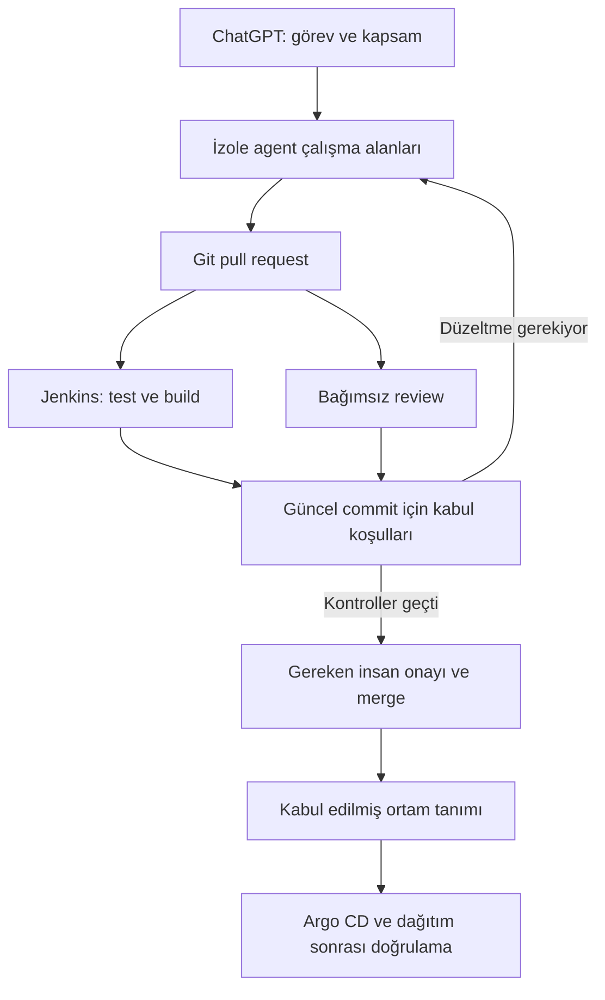

Geliştirme ortamımı artık yalnızca projeyi açıp kod yazdığım bir yer olarak görmüyorum. Araştırma, geliştirme, test, inceleme ve dağıtım adımlarını da bulunduğum yerden yönetiyorum. Kubernetes üzerinde çalışan araçları ve görevleri belirli sınırlar içinde yürüten agent’ları bu amaçla birlikte kullanıyorum.

Bilgisayarın başında olmadığım bir anda aklıma bir geliştirme fikri geldiğinde bunu görev olarak kaydediyorum. Bir servis hata verdiğinde telefondan inceleme başlatıyorum. Ben başka bir işle ilgilenirken agent’lar kanıtları topluyor, ilgili kodu inceliyor ve değerlendirebileceğim bir değişiklik hazırlıyor.

Bu çalışma biçiminde hangi dosyanın değiştiğini, hangi testin geçtiğini ve hangi kararın onayımı beklediğini görebilmek temel ihtiyacım. İşin ilerlemesi kadar, nasıl ilerlediğinin görünür olması da önemli.

[AI’ı nasıl kullandığımı anlattığım yazıda](https://fmarslan.com/tr/2026/08/07/aiyi-nasil-kullaniyorum-operasyonlar-aida-kararlar-bende.html) yaklaşımımı “operasyonlar AI’da, kararlar bende” diye tarif etmiştim. Geliştirme ortamımda da aynı yaklaşımı uyguluyorum.

Argo CD, Codex App Server, tarayıcıdan erişilebilen VS Code, Git repository ve Jenkins pipeline bu yapının parçaları. Asıl tasarım işi ise bu parçalar arasında sorumluluğun, yetkinin ve doğrulamanın nasıl ilerleyeceğini belirlemek.

## Taşınabilir ortamdan, işi sürdürebilen ortama

[Geliştirme ortamımla ilgili önceki yazımda](https://fmarslan.com/2025/12/01/benim-gelistirme-ortamim-hafif-tasinabilir-ve-sade-bir-yaklasim.html) Dev Container merkezli bir düzen anlatmıştım. Her projenin araçları kendi ortamında bulunsun, bilgisayarıma bağımlılıklar yayılmasın ve başka bir cihazdan devam etmek kolay olsun istiyordum.

[TAR Vault Sync üzerinde çalışırken](https://fmarslan.com/2026/09/20/tar-vault-sync-fikirden-ilk-surume-24-saat.html) bu ihtiyacın başka bir tarafı daha belirginleşti: Kaynak kodu geri getirmek, çalışma ortamını geri getirmeye yetmiyor. Yapılandırmalar, secret kaynakları, bağlantılar ve doğrulama adımları da o ortamın parçası.

Aynı projede gereksinim, mimari, geliştirme ve bağımsız QA için farklı agent rolleri kullandım. Kapsamı ve kabul koşullarını açıkça tanımlamanın, agent sayısını artırmaktan daha değerli olduğunu gördüm.

Bu iki deneyimi ortak bir düzende birleştiriyorum: Tekrar kurulabilen bir çalışma ortamı ve o ortamda sınırları belli görevleri sürdürebilen agent’lar.

Kubernetes burada çalışma alanlarını, yardımcı servisleri ve geçici test ortamlarını yönetebileceğim ortak zemin oluyor. Bunun karşılığında platformun bakımını, erişim kurallarını ve kaynak maliyetini de üstleniyorum.

## Parçaların görevini baştan ayırmak

Bu ortamda her bileşenin sorumluluğunu açık tutuyorum:

| Bileşen | Sorumluluğu |
|---|---|
| ChatGPT üzerinden uzaktan erişim | Telefondan görevleri başlatmak, agent’ları yönlendirmek ve sonuçları değerlendirmek |
| Codex App Server | Agent oturumlarını yürütmek, çalışma olaylarını ve onay taleplerini istemciye iletmek |
| Tarayıcıdan VS Code erişimi | Kodu, terminali ve çalışma ortamını gerektiğinde doğrudan incelemek |
| Git ve pull request’ler | Değişikliği, incelemeyi ve karar geçmişini sürümlemek |
| Jenkins | Derleme, test, imaj üretimi ve manifest kontrollerini çalıştırmak |
| Argo CD | Git’te kabul edilmiş ortam tanımını Kubernetes ile uzlaştırmak |

Mobil kullanımda ChatGPT’nin uzaktan çalışma imkânı benim için çok işe yarıyor. Ayrı bir mobil uygulama geliştirmek yerine, telefondan görevleri başlatmak, agent’ları yönlendirmek ve sonuçları değerlendirmek için ChatGPT kullanıyorum.

Codex App Server ise agent oturumları, çalışma olayları ve onay talepleri için kullandığım ayrı bir bileşen. Bu araçların her birini kendi sorumluluğunda değerlendiriyorum. Görevi uzaktan iletmek, agent oturumunu yürütmek ve CI sonuçlarını almak ayrı işler. [Codex App Server dokümantasyonu](https://developers.openai.com/codex/app-server)

VS Code tarafında da tarayıcı editörüyle gerçek çalışma ortamını ayırıyorum. Terminal, derleme ve debug için arkada bir runtime gerekiyor. Tarayıcı editörünü uzak bir çalışma ortamına bağlamak, bu ortamı gerektiğinde elle inceleyebilmemi sağlıyor. [VS Code for the Web](https://code.visualstudio.com/docs/remote/vscode-web)

Telefon benim için görevi başlatma ve sonucu değerlendirme noktası. Ayrıntılı inceleme gerektiğinde aynı işe bilgisayarımdan devam ediyorum.

## Agent’lara uzmanlık verirken yetkiyi de sınırlamak

Tek bir agent’a bütün repository’yi ve bütün cluster yetkilerini verip her şeyi çözmesini istemek yerine, işi sorumluluklara bölüyorum.

Analiz agent’ı ihtiyacı netleştiriyor ve kabul koşullarını çıkarıyor. Uygulama agent’ı ilgili kodu değiştiriyor. Platform agent’ı Helm, Kustomize ve Kubernetes manifestlerini inceliyor. Test agent’ı değişikliğin beklenen davranışı sağlayıp sağlamadığını kontrol ediyor.

Buradaki uzmanlık, rol adını prompt’a yazmakla oluşmuyor. Agent’ın okuyacağı dokümanları, kullanabileceği araçları, değiştirebileceği dosyaları ve üretmesi gereken kanıtları da tanımlamam gerekiyor.

Örneğin platform agent’ı bir Deployment değişikliğinde yalnızca YAML sözdizimine bakmamalı. Probe davranışını, kaynak sınırlarını, servis hesabını, volume ilişkilerini ve rollout etkisini değerlendirmeli. Uygulama agent’ı ise hatayı giderirken mevcut sözleşmeleri ve kullanıcı davranışını korumalı.

Her agent için ayrı çalışma alanı kullanıyorum. Git worktree veya ayrı checkout, eşzamanlı dosya değişikliklerini düzenlemek için yararlı. Güvenlik sınırı gerektiğinde bunun yanında ayrı pod, işletim sistemi izinleri ve ayrı kimlikler de gerekiyor.

İşler paralel ilerleyebilir; ortak dosyalardaki değişikliklerin birleştirilmesi kontrollü olmalı.

## Bağımsız review için ayrı bir App Server

Bu çalışma düzeninde en çok önemsediğim parçalardan biri, geliştirmeyi yapan akıştan ayrı çalışan review katmanı.

Kod yazan agent kendi çözümünü açıklayabilir. Reviewer ise o açıklamayla yetinmemeli. Gereksinimi, değişen dosyaları, test sonuçlarını ve hedef ortamın kurallarını doğrudan incelemeli.

Bu yüzden review için ayrı bir App Server süreci, ayrı bağlam ve ayrı erişim kimliği kullanıyorum. Reviewer kaynak kodu ve CI sonuçlarını okuyabiliyor, PR üzerine bulgu bırakabiliyor. Üretim ortamına dağıtım yapamıyor ve kendi incelemesini aşarak merge gerçekleştiremiyor.

Review çıktısında “uygun görünüyor” gibi bir cümleden fazlasını istiyorum:

- Hangi dosyada, hangi davranışta sorun var?
- Hangi koşulda ortaya çıkabilir?
- Etkisi ne?
- Hangi kanıt veya test eksik?
- Değişiklik merge edilmeden önce ne düzeltilmeli?

Ayrı App Server çalıştırmak model hatalarını tamamen bağımsız hâle getirmiyor. Aynı model ailesi benzer varsayımlara dayanabilir. Riskli değişikliklerde farklı modelle çapraz inceleme, otomatik kontroller ve benim değerlendirmem birlikte devreye girmeli.

Bir başka kritik ayrıntı da incelemenin commit’e bağlı olması. Reviewer bir commit’i onayladıktan sonra PR’a yeni kod gelirse eski onay yeni değişikliği kapsamamalı. Testler ve inceleme, merge edilecek güncel sürüm için geçerli olmalı.

## Telefonda başlayan bir geliştirme senaryosu

Geliştirme akışını somutlaştırmak için şöyle bir görev düşünelim:

> “Sipariş servisinde aynı mesaj yeniden geldiğinde mükerrer kayıt oluşabiliyor. Akışı incele, sorunu yeniden üreten bir test hazırla ve çözümü PR olarak getir. Production’a dağıtma.”

ChatGPT üzerinden görevi iletirken repository’yi, hedef ortamı, kabul koşullarını ve izin verilen işlemleri açıkça belirtiyorum. Aynı sınırlar görev kaydında ve PR üzerinde de görünür olmalı.

Analiz agent’ı mesaj tüketim akışını inceliyor. Uygulama agent’ı çözümü hazırlıyor. Test agent’ı aynı mesajın yeniden gelmesini ve ilgili hata koşullarını doğruluyor. Manifest değişikliği gerekiyorsa platform agent’ı o kısmı ayrıca değerlendiriyor.

Jenkins, PR’daki kod için derleme ve testleri çalıştırıyor. Kubernetes eklentisiyle build işlerini geçici agent pod’larında yürütmek mümkün; kullanılacak araçları ve kaynakları pipeline’ın ihtiyacına göre tanımlayabiliyorum. [Jenkins Kubernetes eklentisi](https://plugins.jenkins.io/kubernetes/)

Bağımsız reviewer güncel değişikliği inceliyor. Eksik bulursa notlar görev akışına dönüyor. Düzeltme geldikten sonra ilgili kontroller yeniden çalışıyor.

Telefondan değerlendirdiğim sonuçta değişikliğin özeti, PR bağlantısı, geçen testler, açık bulgular ve beklenen karar bulunmasını önemsiyorum. Örneğin mükerrer kaydı önleyen çözüm hazırlanmış olabilir; fakat mevcut mükerrer verilerin temizlenmesi ayrı bir karar olarak karşıma çıkmalıdır.

Böylece geliştirme işiyle veri düzeltme operasyonunun sınırı görünür kalıyor.

## Jenkins ile Argo CD’nin sınırını korumak

[Kubernetes, Helm, Kustomize ve GitOps üzerine yazımda](https://fmarslan.com/tr/2026/07/28/kubernetes-kustomize-helm-chart-ve-gitops-nedir.html) anlattığım yaklaşım burada da temel oluşturuyor.

Jenkins kodu doğruluyor, imajı üretiyor ve registry’ye gönderiyor. Dağıtılacak imajın digest’i ortam repository’sindeki tanıma giriyor. Bu değişiklik de kendi inceleme ve onay sürecinden geçiyor.

Argo CD, kabul edilmiş ortam tanımını cluster’a uyguluyor. Otomatik sync, canlı değişiklikleri geri uzlaştıran self-heal ve Git’ten çıkarılan kaynakları silen prune ayrı davranışlar; her ortam için bilinçli seçilmeleri gerekiyor. [Argo CD otomatik senkronizasyon politikası](https://argo-cd.readthedocs.io/en/stable/user-guide/auto_sync/)

Development ve production için aynı yetki modelini kullanmıyorum. Hangi değişikliklerin önceden tanımlı kurallarla ilerleyebileceğini, hangilerinin açık onay gerektirdiğini ortamın etkisine göre ayırıyorum.

PR içindeki kod çalıştırılırken üretim secret’larını build ortamına vermemek de bu ayrımın parçası. Pipeline dosyası veya build betiği değiştirebilen bir agent, bu yolla kendi yetkisini genişletememeli.

Dağıtımın tamamlanmasını yalnızca pod’ların başlamasıyla ölçmüyorum. İlgili iş akışı, hata oranı ve kullanıcıya yansıyan davranış da doğrulanmalı.

## Hata analizinde önce kanıt toplamak

Aynı ortamı operasyonel incelemeler için de kullanıyorum.

Telefondan şöyle bir talep başlatabilirim:

> “Son dağıtımdan sonra ödeme servisinde timeout arttı. Son değişikliklerle log, metrik ve trace bilgilerini karşılaştır. Önce analiz yap, ortamı değiştirme.”

Agent bu durumda başlangıçta salt okunur araçlarla çalışıyor. Son dağıtım zamanını, çalışan imajı, pod event’lerini, kaynak kullanımını ve ilgili hata örneklerini topluyor.

[Event-driven sistemlerde debug’ın neden yeterli olmadığını anlattığım yazıda](https://fmarslan.com/2025/11/29/event-driven-mimaride-debug-neden-yetmez.html) vurguladığım gözlemlenebilirlik burada doğrudan değer üretiyor. Dağıtık bir akışı yalnızca tek servisin logundan anlamak zor. Trace ve correlation bilgisi, agent’ın incelemesini de daha anlamlı hâle getiriyor.

Beklediğim rapor, bulguyla varsayımı ayırmalı:

> “Hata artışı son dağıtımdan sonra başlamış. İlgili çağrılarda bağlantı havuzu bekleme süresi yükselmiş. Yeni yapılandırma olası neden; doğrulamak için staging’de karşılaştırmalı test gerekiyor.”

Bu sonuç, müdahale kararını değerlendirebileceğim bir temel sağlıyor. Eksik kanıt varsa agent’ın bunu açıkça söylemesi gerekiyor.

Geri alma kararında da GitOps düzenini koruyorum. Önceki imaj digest’ini ortam repository’sine geri taşıyan değişiklik izlenebilir olmalı. Veritabanı migration’ı varsa uygulama sürümünü geri almak tek başına yeterli olmayabilir; bu uyumluluk ayrıca değerlendirilmelidir.

## Benim için tam otomasyonun anlamı

Araştırma, geliştirme, test, inceleme ve dağıtım hazırlığını mümkün olduğunca agent’lara devrediyorum. Karar gerektiren noktaları ise aynı akış içinde görünür tutuyorum.

Bunun için kodun yanında çalışma kurallarını da sürümlemek gerekiyor. Agent talimatları, kabul koşulları, Jenkinsfile, Kubernetes manifestleri ve operasyon dokümanları birlikte gelişmeli. Ancak agent’ların yetkisini belirleyen üst politikalar, geliştirme agent’ının kolayca değiştirebileceği dosyalara bırakılmamalı.

Operasyon geçmişi de konuşma penceresine sıkışmamalı. Görev kaydı, PR, test sonucu, review bulgusu ve dağıtım kaydı birbirine bağlanmalı. Telefonu kapatıp birkaç saat sonra döndüğümde işin nerede kaldığını görebilmeliyim.

Bu çalışma düzeninin maliyeti var. Agent oturumları kaynak ve token tüketiyor; çalışma ortamları, kimlikler ve pipeline’lar bakım istiyor. Bu nedenle her görev için bütün rolleri çalıştırmak yerine, işin kapsamına göre gerekli olanları devreye almak daha anlamlı.

Bu düzeni kullanırken baktığım ölçüt şu: Telefonda tarif ettiğim ihtiyaç, görev kaydından PR’a ve doğrulama sonuçlarına kadar izlenebiliyor mu? Karşıma gelen sonuçta hangi sürüme, hangi kanıtlara ve hangi etkiye onay verdiğim açık mı?

Benim için bu çalışma biçiminin değeri, bilgisayardan uzaktayken de işin kontrollü biçimde ilerleyebilmesi. Sistemin ne yaptığını anlayabilmek, gerektiğinde durdurabilmek ve kararın sorumluluğunu taşımaya devam etmek.

Operasyonları daha fazla devredebilirim. Sonucun sahipliği yine bende kalır.